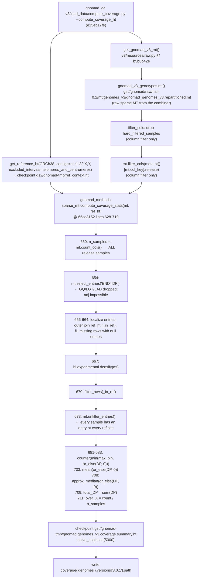

# v3 genomes coverage (release 3.0.1) — exact code flow (review aid)

> Scratch doc, not intended to be committed. Reconstructs the code that produced the gnomAD **genomes 3.0.1** coverage HT
> (the table v5 `compute_coverage.py --merge-gnomad-coverage` subtracts consent-drop samples from).
> Every snippet below is quoted verbatim from git at the commit that was in effect for the run; line numbers are from that commit.
>
> **Run:** July 2020 (per the warning laurent added to the script on 2020-08-17).
> **gnomad_qc:** [compute_coverage.py](compute_coverage.py) @ `e15eb17fe` (2020-08-17, "Updated coverage version"). The computation lines
> (28–34) are byte-identical back to the file's creation @ `7631dd09d` (2020-02-26).
> **gnomad_methods:** `gnomad/utils/sparse_mt.py::compute_coverage_stats` @ `65ca8152` (2020-07-23). The two commits immediately
> before the run (`239390be` 2020-07-22, `65ca8152` 2020-07-23) edit only this function; `239390be` introduced the
> `median_approx` field name, which is the name in the released 3.0.1 HT. The next change (`22465677`, 2020-08-17) added the
> `3.0.1` resource version and only appended `.select_cols().select_rows()` on line 654.
> **Output:** `gs://gcp-public-data--gnomad/release/3.0.1/coverage/genomes/gnomad.genomes.r3.0.1.coverage.ht`
> (`mean: float64, median_approx: int32, total_DP: int64, over_{1,5,10,15,20,25,30,50,100}: float32`; no globals).

---

## 1. Flowchart



No node in this graph reads `GQ`, `LAD`, `adj`, or calls `filter_entries`. The only filters are the two `filter_cols` (samples), and
`unfilter_entries` + `or_else(DP, 0)` force every remaining sample into the denominator at every site.

---

## 2. gnomad_qc side — `v3/load_data/compute_coverage.py` @ `e15eb17fe`

```python
11  def main(args):
12      hl.init(default_reference='GRCh38')
13      logger = logging.getLogger("gnomad_qc.v3.load_data.compute_coverage")
14
15      logger.warning("Last time this was run (July 2020), this script required high-mem machines.")
16
17      if args.compute_coverage_ht:
18
19          print("Building reference context HT")
20          ref_ht = get_reference_ht(
21              hl.get_reference('GRCh38'),
22              contigs=[f'chr{x}' for x in range(1,23)] + ['chrX', 'chrY'],
23              excluded_intervals=telomeres_and_centromeres.ht().interval.collect()
24          )
25          ref_ht = ref_ht.checkpoint("gs://gnomad-tmp/ref_context.ht", overwrite=True)
26          logger.info("Done building reference context HT")
27
28          mt = get_gnomad_v3_mt()
29          mt = mt.filter_cols(meta.ht()[mt.col_key].release)
30
31          coverage_ht = compute_coverage_stats(
32              mt,
33              ref_ht
34          )
35
36          coverage_ht = coverage_ht.checkpoint('gs://gnomad-tmp/gnomad.genomes_v3.coverage.summary.ht', overwrite=True)
37          coverage_ht = coverage_ht.naive_coalesce(5000)
38
39          coverage_ht.write(coverage('genomes').versions['3.0.1'].path, overwrite=args.overwrite)
```

### `get_gnomad_v3_mt` — `v3/resources/raw.py` @ `b5b0b42e` (2020-05-07; last change before the run)

```python
 7  def get_gnomad_v3_mt(
 8          key_by_locus_and_alleles: bool = False,
 9          remove_hard_filtered_samples: bool = True,
10          release_only: bool = False,
11          samples_meta: bool = False
12  ) -> hl.MatrixTable:
13      mt = gnomad_v3_genotypes.mt()
14      if key_by_locus_and_alleles:
15          mt = hl.MatrixTable(hl.ir.MatrixKeyRowsBy(mt._mir, ['locus', 'alleles'], is_sorted=True))
16
17      if remove_hard_filtered_samples:
18          mt = mt.filter_cols(hl.is_missing(hard_filtered_samples.ht()[mt.col_key]))
19
20      if samples_meta:
21          mt = mt.annotate_cols(meta=meta.ht()[mt.col_key])
22
23          if release_only:
24              mt = mt.filter_cols(mt.meta.release)
25
26      elif release_only:
27          mt = mt.filter_cols(meta.ht()[mt.col_key].release)
28
29      return mt
...
33  gnomad_v3_genotypes = MatrixTableResource("gs://gnomad/raw/hail-0.2/mt/genomes_v3/gnomad_genomes_v3.repartitioned.mt")
```

Four options, all column-level. No entry annotation, no entry filter, no adj option existed.

---

## 3. gnomad_methods side — `gnomad/utils/sparse_mt.py::compute_coverage_stats` @ `65ca8152`

```python
628  def compute_coverage_stats(
629      mt: hl.MatrixTable,
630      reference_ht: hl.Table,
631      coverage_over_x_bins: List[int] = [1, 5, 10, 15, 20, 25, 30, 50, 100],
632  ) -> hl.Table:
...
650      n_samples = mt.count_cols()
651      print(f"Computing coverage stats on {n_samples} samples.")
652
653      # Create an outer join with the reference Table
654      mt = mt.select_entries("END", "DP")
655      col_key_fields = list(mt.col_key)
656      t = mt._localize_entries("__entries", "__cols")
657      t = t.join(reference_ht.select(_in_ref=True).key_by(*mt.row_key), how="outer")
658      t = t.annotate(
659          __entries=hl.or_else(
660              t.__entries,
661              hl.range(n_samples).map(lambda x: hl.null(t.__entries.dtype.element_type)),
662          )
663      )
664      mt = t._unlocalize_entries("__entries", "__cols", col_key_fields)
665
666      # Densify
667      mt = hl.experimental.densify(mt)
668
669      # Filter rows where the reference is missing
670      mt = mt.filter_rows(mt._in_ref)
671
672      # Unfilter entries so that entries with no ref block overlap aren't null
673      mt = mt.unfilter_entries()
674
675      # Compute coverage stats
676      coverage_over_x_bins = sorted(coverage_over_x_bins)
677      max_coverage_bin = coverage_over_x_bins[-1]
678      hl_coverage_over_x_bins = hl.array(coverage_over_x_bins)
679
680      # This expression creates a counter DP -> number of samples for DP between 0 and max_coverage_bin
681      coverage_counter_expr = hl.agg.counter(
682          hl.min(max_coverage_bin, hl.or_else(mt.DP, 0))
683      )
...
703      mean_expr = hl.agg.mean(hl.or_else(mt.DP, 0))
704
705      # Annotate rows now
706      return mt.select_rows(
707          mean=hl.cond(hl.is_nan(mean_expr), 0, mean_expr),
708          median_approx=hl.or_else(hl.agg.approx_median(hl.or_else(mt.DP, 0)), 0),
709          total_DP=hl.agg.sum(mt.DP),
710          **{
711              f"over_{x}": count_array_expr[i] / n_samples
712              for i, x in zip(
713                  range(
714                      len(coverage_over_x_bins) - 1, -1, -1
715                  ),  # Reverse the bin index as count_array_expr has the reverse order
716                  coverage_over_x_bins,
717              )
718          },
719      ).rows()
```

`grep -n "adj\|GQ\|filter_entries"` over lines 628–719 returns nothing.

### The July 2020 diff (`239390be`) shows the intent

```diff
-    t = t.join(reference_ht.annotate(_in_ref=True), how="outer")
+    t = t.join(reference_ht.select(_in_ref=True).key_by('locus'), how="outer")
+    # Unfilter entries so that entries with no ref block overlap aren't null
+    mt = mt.unfilter_entries()
-        hl.or_else(hl.min(max_coverage_bin, mt.DP), 0)
+        hl.min(max_coverage_bin, hl.or_else(mt.DP, 0))
-    mean_expr = hl.agg.mean(mt.DP)
+    mean_expr = hl.agg.mean(hl.or_else(mt.DP, 0))
-        median=hl.or_else(hl.agg.approx_median(mt.DP), 0),
+        median_approx=hl.or_else(hl.agg.approx_median(hl.or_else(mt.DP, 0)), 0),
```

The fix made uncovered samples count as DP = 0 rather than be dropped — the opposite direction from an adj filter.

---

## 4. Why this matters for the v5 merge

| line | consequence |
|---|---|
| 650 + 703 | `mean = Σ or_else(DP,0) / n_samples` → **`mean × n_samples == total_DP` exactly** |
| 650 + 711 | `over_X = (# samples with DP ≥ X) / n_samples`, `n_samples` = all release samples |
| 654 | GQ/LAD never present → an adj filter was not possible even if wanted |

v5 `_rename_cov_annotations` ([v5/annotations/compute_coverage.py:893](../../v5/annotations/compute_coverage.py#L893)) relies on the first identity
(`sum = mean * sample_count`). It holds for 3.0.1 only because nothing was filtered. The consent-drop HT on `mw/an_batch_updates` pins
`coverage_stats` to `GNOMAD_COVERAGE_GROUP = {"group": "adj", ...}`, which makes `agg_by_strata` wrap the aggregation in
`hl.agg.filter(adj, …)`, so its `mean` denominator is the per-site adj count, not 849, and the identity breaks (review finding X2).

---

## 5. Empirical confirmation on the released 3.0.1 HT

Under an adj filter (DP ≥ 10 required), `over_1 > over_10` is impossible. chr22:10,510,000–11,000,000:

| sites | `over_1 > over_10` | `over_5 > over_10` | example |
|---|---|---|---|
| 356,724 | 261,978 | 248,106 | chr22:10510001 mean 0.017, over_1 0.0066, over_5 0.00095, over_10 0 |
