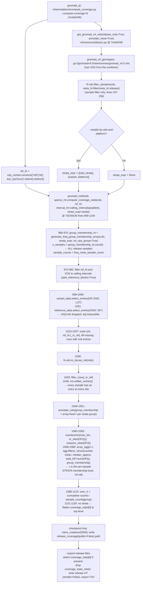

# v4 exomes coverage (release 4.0) — exact code flow (review aid)

> Scratch doc, not intended to be committed. Reconstructs the code that produced the gnomAD **exomes 4.0** coverage HT.
> (gnomAD v4 **genomes** has no v4 coverage computation: it reuses genomes 3.0.1 — see
> [v3/load_data/compute_coverage_flowchart.md](../../v3/load_data/compute_coverage_flowchart.md).)
> Every snippet is quoted verbatim from git at the commit in effect for the run; line numbers are from that commit.
>
> **Run:** Oct 2023, ahead of the v4.0 release (2023-11-01).
> **gnomad_qc:** [compute_coverage.py](compute_coverage.py) @ `7e4af1f46` (2023-10-30, last of klaricch's release-prep commits;
> file created `abf37eaa3` 2023-08-23). `get_gnomad_v4_vds` from `v4/resources/basics.py` @ the same commit.
> **gnomad_methods:** `gnomad/utils/sparse_mt.py::compute_coverage_stats` @ `70240e30` (2023-10-05; last change to the file before
> the run). This is the pre-`agg_by_strata` implementation — `compute_stats_per_ref_site` did not exist until `d1488bd5` (2024-01-10).
> **Output:** `gs://gcp-public-data--gnomad/release/4.0/coverage/exomes/gnomad.exomes.v4.0.coverage.ht`
> (`mean: float64, median_approx: int32, total_DP: int64, over_{1,…,100}: float64`; no globals — i.e. the flat, unstratified form).

---

## 1. Flowchart



No node reads `GQ`, `LAD`, or `adj`, and nothing calls `filter_entries`. The only `hl.agg.filter` (line 1068) is on the
strata-membership boolean; with `strata_expr=None` it is a single all-`True` group.

---

## 2. gnomad_qc side — `v4/annotations/compute_coverage.py` @ `7e4af1f46`

```python
103          if args.compute_coverage_ht:
104              logger.info("Running compute coverage...")
105              res = coverage_resources.compute_coverage_ht
106              res.check_resource_existence()
107              # Read in context Table.
108              ref_ht = vep_context.versions["105"].ht()
109              if test:
110                  ref_ht = ref_ht._filter_partitions(range(50))
111
112              # Retain only 'locus' annotation from context Table
113              ref_ht = ref_ht.key_by("locus").select().distinct()
114
115              # Read in VDS.
116              vds = get_gnomad_v4_vds(
117                  release_only=True,
118                  test=test,
119                  filter_partitions=range(2) if test else None,
120                  annotate_meta=True,
121              )
122
123              if args.stratify_by_ukb_and_platform:
124                  meta_expr = vds.variant_data.meta
125                  ukb_expr = meta_expr.project_meta.ukb_sample
126                  strata = [
127                      {"ukb_strata": hl.if_else(ukb_expr, "ukb", "non_ukb")},
128                      {
129                          "subset": hl.or_missing(~ukb_expr, "non_ukb"),
130                          "platform": meta_expr.platform_inference.qc_platform,
131                      },
132                  ]
133              else:
134                  strata = None
135
136              # Compute coverage stats.
137              coverage_ht = compute_coverage_stats(
138                  vds,
139                  ref_ht,
140                  interval_ht=res.interval_ht.ht(),
141                  strata_expr=strata,
142              )
...
157              coverage_ht = coverage_ht.checkpoint(
158                  hl.utils.new_temp_file("coverage", extension="ht")
159              )
160
161              # Naive coalesce and write out final Table.
162              coverage_ht = coverage_ht.naive_coalesce(5000)
163              coverage_ht.write(res.coverage_ht.path, overwrite=overwrite)
164
165          if args.export_release_files:
166              logger.info("Exporting coverage tsv...")
167              res = coverage_resources.export_coverage_files
168              res.check_resource_existence()
169              ht = res.coverage_ht.ht()
170              if "coverage_stats" in ht.row:
171                  ht = ht.select(
172                      **{k: ht.coverage_stats[0][k] for k in ht.coverage_stats[0]}
173                  )
174              ht = ht.drop("coverage_stats_meta", "coverage_stats_meta_sample_count")
175              ht = ht.checkpoint(res.release_ht.path, overwrite=overwrite)
176              ht.export(res.coverage_tsv)
```

Whether or not `--stratify-by-ukb-and-platform` was used, the released table is `coverage_stats[0]`: with `no_raw_group=True`
the first `freq_meta` entry is the all-samples group, so group 0 is every release sample either way.

### `get_gnomad_v4_vds` — `v4/resources/basics.py` @ `7e4af1f46`, `release_only` branch

```python
247      if release_only:
248          logger.info("Filtering VDS to release samples only...")
249          if test:
250              meta_ht = gnomad_v4_testset_meta.ht()
251          else:
252              meta_ht = meta().ht()
253          filter_expr = meta_ht.release
254          if keep_controls:
255              filter_expr |= hl.literal(TRUTH_SAMPLES_S).contains(meta_ht.s)
256          vds = hl.vds.filter_samples(vds, meta_ht.filter(filter_expr))
...
285  _gnomad_v4_genotypes = {
286      "4.0": VariantDatasetResource("gs://gnomad/v4.0/raw/exomes/gnomad_v4.0.vds")
287  }
```

Every filter in the function is `hl.vds.filter_samples`; there is no `filter_entries`, `annotate_entries`, or adj anywhere in it.

---

## 3. gnomad_methods side — `gnomad/utils/sparse_mt.py::compute_coverage_stats` @ `70240e30`

```python
909  def compute_coverage_stats(
910      mtds: Union[hl.MatrixTable, hl.vds.VariantDataset],
911      reference_ht: hl.Table,
912      interval_ht: Optional[hl.Table] = None,
913      coverage_over_x_bins: List[int] = [1, 5, 10, 15, 20, 25, 30, 50, 100],
914      row_key_fields: List[str] = ["locus"],
915      strata_expr: Optional[List[Dict[str, hl.expr.StringExpression]]] = None,
916  ) -> hl.Table:
...
946      if strata_expr is None:
947          strata_expr = {}
948          no_strata = True
949      else:
950          no_strata = False
...
957      # Use the function for creating the frequency stratified by `freq_meta`,
958      # `freq_meta_sample_count`, and `group_membership` annotations to give
959      # stratification group membership info for computing coverage. By default, this
960      # function returns annotations where the second element is a placeholder for the
961      # "raw" frequency of all samples, where the first 2 elements are the same sample
962      # set, but freq_meta startswith [{"group": "adj", "group": "raw", ...]. Use
963      # `no_raw_group` to exclude the "raw" group so there is a single annotation
964      # representing the full samples set. `freq_meta` is updated below to remove "group"
965      # from all dicts.
966      group_membership_ht = generate_freq_group_membership_array(
967          ht, strata_expr, no_raw_group=True
968      )
969      n_samples = group_membership_ht.count()
970      sample_counts = group_membership_ht.index_globals().freq_meta_sample_count
...
990      def join_with_ref(mt: hl.MatrixTable) -> hl.MatrixTable:
...
999          keep_entries = ["DP"]
1000         if "END" in mt.entry:
1001             keep_entries.append("END")
1002         if "LGT" in mt.entry:
1003             keep_entries.append("LGT")
1004         if "GT" in mt.entry:
1005             keep_entries.append("GT")
...
1008         t = mt.select_entries(*keep_entries).select_cols().select_rows()
...
1029     if is_vds:
1030         mtds = hl.vds.VariantDataset(
1031             mtds.reference_data.select_entries("END", "DP").select_cols().select_rows(),
1032             join_with_ref(mtds.variant_data),
1033         )
1034
1035         # Densify
1036         mt = hl.vds.to_dense_mt(mtds)
...
1042     # Filter rows where the reference is missing
1043     mt = mt.filter_rows(mt._in_ref)
1044
1045     # Unfilter entries so that entries with no ref block overlap aren't null
1046     mt = mt.unfilter_entries()
1047
1048     # Annotate with group membership
1049     mt = mt.annotate_cols(
1050         group_membership=group_membership_ht[mt.col_key].group_membership
1051     )
...
1060     coverage_counter_expr = hl.agg.counter(
1061         hl.min(max_coverage_bin, hl.or_else(mt.DP, 0))
1062     )
1063     mean_expr = hl.agg.mean(hl.or_else(mt.DP, 0))
1064
1065     # Annotate all rows with coverage stats for each strata group.
1066     ht = mt.select_rows(
1067         coverage_stats=hl.agg.array_agg(
1068             lambda x: hl.agg.filter(
1069                 x,
1070                 hl.struct(
1071                     coverage_counter=coverage_counter_expr,
1072                     mean=hl.if_else(hl.is_nan(mean_expr), 0, mean_expr),
1073                     median_approx=hl.or_else(
1074                         hl.agg.approx_median(hl.or_else(mt.DP, 0)), 0
1075                     ),
1076                     total_DP=hl.agg.sum(mt.DP),
1077                 ),
1078             ),
1079             mt.group_membership,
1080         )
1081     ).rows()
...
1108     ht = ht.annotate(
1109         coverage_stats=hl.map(
1110             lambda c, g, n: c.annotate(
1111                 **{
1112                     f"over_{x}": g[i] / n
...
1120             ht.coverage_stats,
1121             count_array_expr,
1122             sample_counts,
1123         )
1124     )
...
1131     if no_strata:
1132         # If there was no stratification, move coverage_stats annotations to the top
1133         # level.
1134         ht = ht.select(**{k: ht.coverage_stats[0][k] for k in ht.coverage_stats[0]})
```

The word `adj` appears in this function only in the comment on line 962, describing a **label** in `freq_meta` that the comment
itself says is stripped. `x` in `hl.agg.filter(x, …)` (line 1068) is `mt.group_membership[i]`, a per-sample strata-membership
boolean. Nothing computes or reads an adj entry field, and lines 999–1008/1031 remove GQ and LAD before densify so nothing could.

---

## 4. Contrast with today's `main` and with v5

- `compute_coverage_stats` on `main` now delegates to `compute_stats_per_ref_site`, which (when no `group_membership_ht` is passed)
  logs `"'group_membership_ht' is not specified, no stats are adj filtered."` and builds the groups with `group_label="raw"`,
  commented `"The per-ref-site stats path does no genotype-level filtering"` (`sparse_mt.py` ≈1317–1341). Same semantics as above.
- v4's *AN and qual-hist* step ([compute_coverage.py:492-517](compute_coverage.py#L492-L517), added Feb 2024 after the 4.0 release) is the
  only place v4 passes an adj-labelled `group_membership_ht`; that is AN, which is adj by definition, and it never touches coverage.
- v5 `mw/an_batch_updates` pins `coverage_stats` to `GNOMAD_COVERAGE_GROUP = {"group": "adj", "v3_release": "true"}`
  ([v5/annotations/compute_coverage.py:162](../../v5/annotations/compute_coverage.py#L162), [:774](../../v5/annotations/compute_coverage.py#L774)).
  In `agg_by_strata` a `freq_meta` entry with `"group": "adj"` sets `adj_groups[i] = True`, which wraps the aggregation in
  `hl.agg.filter(ht.adj[i], …)`. That is the first gnomAD coverage computation ever routed through an adj filter (review finding X2).

---

## 5. Empirical confirmation on the released 4.0 exomes HT

Under an adj filter (DP ≥ 10 required), `over_1 > over_10` is impossible. chr22:17,000,000–19,000,000:

| sites | `over_1 > over_10` | `over_1 > over_5` | example |
|---|---|---|---|
| 278,112 | 275,154 | 271,424 | chr22:17007889 mean 25.2, over_1 0.999, over_5 0.968, over_10 0.914, over_20 0.681 |
