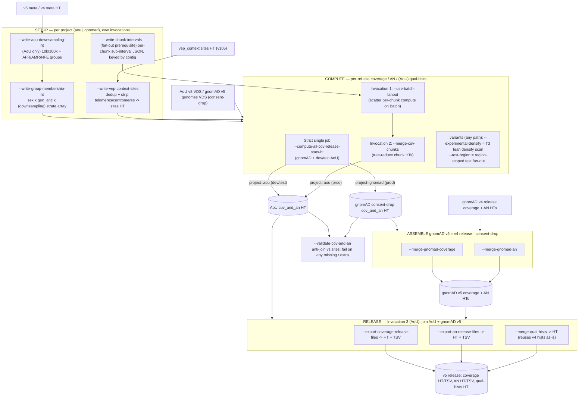
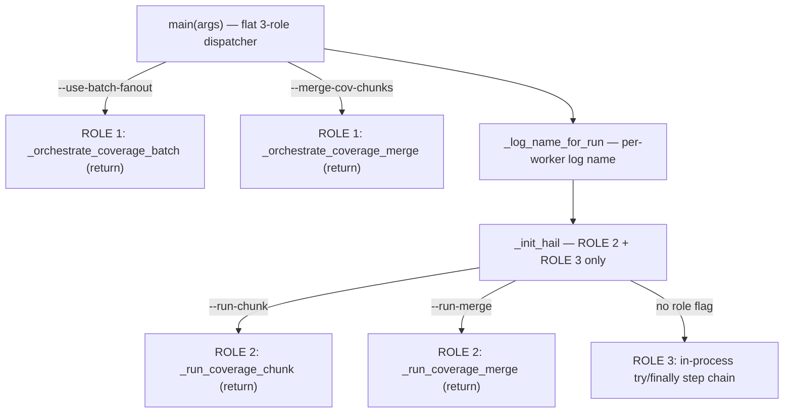
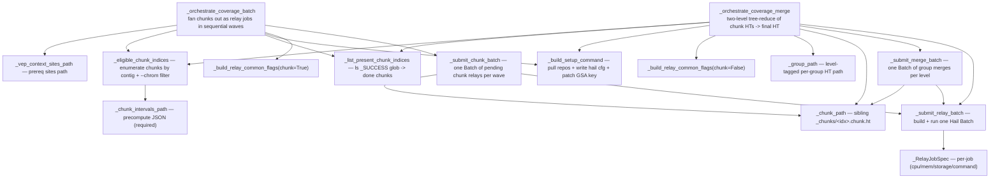
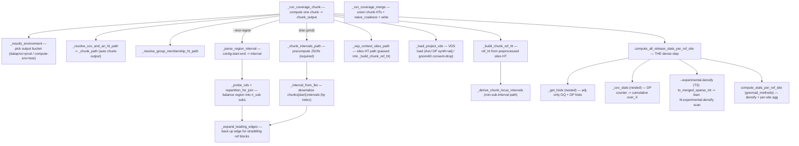

# `compute_coverage.py` — flowcharts (review aid)

> Scratch doc for reading [compute_coverage.py](compute_coverage.py) as it changes; not intended to be committed.
> Two charts: (1) **high level** organized by pipeline stage / CLI invocation, (2) **detailed** function call-graph
> split by the 3 execution roles, plus a one-line function reference. Node labels carry the CLI flag that triggers each step.
>
> The detailed charts are a **curated** call graph (readability over completeness): trivial path-helper plumbing and
> secondary edges to an already-shown node are omitted. Synced to branch `mw/an_batch_updates` @ `5d69f5c7`.
> Fan-out chunks are now **contig-keyed**: `--write-chunk-intervals` is a hard prerequisite, `--chunk-start` is a
> chunk *index* (not a partition index), and `--chrom` selects a contig's chunks.

---

## 1. High-level flowchart — pipeline stages / invocations

A full **prod AoU release is 3 separate CLI invocations** (fan-out compute → merge → assembly); gnomAD + dev/test use the
strict single-job compute instead. Setup HTs are written by their own in-process invocations first.

---

## 2. Detailed flowchart — function call-graph (by execution role)

### 2a. Role dispatch — `main(args)`

`__main__` (line 3628) parses args + enforces mutual-exclusivity (`parser.error`), then calls `main`. `main` is a flat
dispatcher: ROLE 1 returns before `_init_hail`; ROLE 2 + ROLE 3 init Hail first.

### 2b. ROLE 1 — orchestrators (submit Hail Batch of relay jobs, no Hail compute here)

### 2c. ROLE 2 — workers (one chunk / one merge inside a relay container)

### 2d. ROLE 3 — in-process pipeline (try/finally step chain; one block per CLI flag)

```mermaid
flowchart TD
  P3["try/finally step chain"]
  P3 --> WS["--write-vep-context-sites"]
  WS --> BVCS["_build_vep_context_sites_ht — dedup + strip telomeres/centromeres"]
  WS --> PVa["(test) _probe_vds + _derive_chunk_locus_intervals — scope sites"]
  P3 --> WCI["--write-chunk-intervals (fan-out prerequisite)"]
  WCI --> BCI["_build_chunk_intervals — all chunks' sub-intervals in 1 VDS open, grouped by contig"]
  BCI --> STC["_split_intervals_at_contigs — cut contig-straddling sub-intervals"]
  BCI --> ITL["_interval_to_list — serialize intervals to JSON"]
  P3 --> WDS["--write-aou-downsampling-ht"]
  WDS --> GDH["get_downsampling_ht — 10k/100k + AFR/AMR/NFE downsampling groups"]
  P3 --> WGM["--write-group-membership-ht"]
  WGM --> GGMH["get_group_membership_ht — sex x gen_anc x (ds) strata membership array"]
  P3 --> CC["--compute-all-cov-release-stats-ht (strict single-job compute)"]
  CC --> DRPI["_derive_ref_partition_intervals / _probe_vds — optional co-partition"]
  CC --> LPV2["_load_project_vds"]
  CC --> BCRH2["_build_chunk_ref_ht"]
  CC --> CARS2["compute_all_release_stats_per_ref_site"]
  P3 --> VC["--validate-cov-and-an — anti_join vs sites + count checks"]
  VC --> VSP3["_vep_context_sites_path"]
  P3 --> MGC["--merge-gnomad-coverage"]
  MGC --> GMP["_gnomad_v5_merged_path"]
  MGC --> FLB1["(test) _filter_to_locus_bounds"]
  MGC --> MGCH["merge_gnomad_coverage_hts"]
  MGCH --> RCA["_rename_cov_annotations"]
  MGCH --> MCF["_merge_coverage_fields"]
  P3 --> MGA["--merge-gnomad-an"]
  MGA --> GMP
  MGA --> MGAH["merge_gnomad_an_hts"]
  MGAH --> RF["_rename_fields"]
  MGAH --> MAF["_merge_an_fields"]
  P3 --> EC["--export-coverage-release-files"]
  EC --> RE2["_results_environment — route release artifacts to gnomAD (dataproc) bucket"]
  EC --> JAGC["join_aou_and_gnomad_coverage_ht"]
  JAGC --> RCA
  JAGC --> MCF
  P3 --> EA["--export-an-release-files"]
  EA --> RE2
  EA --> JAGA["join_aou_and_gnomad_an_ht — + append gnomAD as non-aou subset"]
  JAGA --> RF
  JAGA --> MAF
  P3 --> MQH["--merge-qual-hists"]
  MQH --> AP["_apply_path_suffix"]
  MQH --> JAGQ["join_aou_and_gnomad_qual_hists_ht"]
  JAGQ --> RF
  P3 --> FIN["finally: hl.copy_log (non-batch envs only)"]
```

---

## 3. Function reference — one line each

### Entry / dispatch
| Function | What it does |
| --- | --- |
| `get_script_argument_parser` | Builds the argparse parser with every CLI flag / argument group. |
| `main` | Flat dispatcher over the 3 mutually-exclusive process roles. |
| `_log_name_for_run` | Per-worker log basename so concurrent chunk/merge workers don't clobber the log. |
| `_init_hail` *(resources)* | Configured Hail init (QoB/dataproc); reached by ROLE 2 + ROLE 3 only. |

### Path helpers
| Function | What it does |
| --- | --- |
| `_chunk_path` | Sibling per-chunk HT path `<base>_chunks/<idx>.chunk.ht`. |
| `_group_path` | Level-tagged per-group merged HT path (encodes tree shape). |
| `_apply_path_suffix` | Insert `_<suffix>` before `.ht` (A/B comparison runs). |
| `_resolve_cov_and_an_ht_path` | Resolve the cov_and_an HT path, applying suffix. |
| `_resolve_group_membership_ht_path` | Resolve group_membership path, `_reduce` under `--reduce-min-aggs`. |
| `_gnomad_v5_merged_path` | Path for the gnomAD v5 consent-drop-subtracted coverage/AN HT. |
| `_vep_context_sites_path` | Path to the preprocessed vep_context sites HT (pinned to dataproc). |
| `_chunk_intervals_path` | Path to the precomputed per-chunk sub-intervals JSON (list indexed by chunk, tagged by contig). |
| `_results_environment` | Bucket-selecting env for release artifacts (prod→dataproc, test→compute env, or `--results-environment`). |
| `_list_present_chunk_indices` | One `_SUCCESS` glob -> set of completed chunk indices. |

### Setup builders
| Function | What it does |
| --- | --- |
| `get_downsampling_ht` | AoU downsampling groups: 10k/100k + per-group AFR/AMR/NFE. |
| `get_group_membership_ht` | sex × gen_anc × (downsampling) strata membership array (AoU or gnomAD consent-drop). |
| `_build_vep_context_sites_ht` | Locus-keyed, deduped, telomere/centromere-stripped sites HT. |
| `_build_chunk_intervals` | Every chunk's balanced read sub-intervals in ONE VDS open; split + grouped by contig -> JSON list. |
| `_split_intervals_at_contigs` | Cut any sub-interval straddling a contig boundary into one-per-contig (contig-keyed chunking). |
| `_interval_to_list` / `_interval_from_list` | Serialize / deserialize a locus interval to/from a JSON list. |

### VDS / ref-site loaders
| Function | What it does |
| --- | --- |
| `_load_project_vds` | Per-project VDS load (AoU DP-synth + adj / gnomAD consent-drop), filter_partitions vs read_intervals. |
| `_probe_vds` | Cheap reference_data-bounds VDS load (no sample filtering / DP synth). |
| `_derive_chunk_locus_intervals` | Per-contig locus sub-intervals covering a filtered VDS chunk. |
| `_derive_ref_partition_intervals` | Balanced vep_context intervals via `repartition_for_join` (strict path). |
| `_parse_region_interval` | Parse `contig:start-end` into a half-open Python locus interval (`--test-region`). |
| `_build_chunk_ref_ht` | Per-chunk `ref_ht` from the preprocessed sites HT (read-time pruned). |
| `_expand_leading_edges` | Back up each contig's first interval by `ref_block_max_length-1` to catch straddling blocks. |
| `_filter_to_locus_bounds` | Filter a target HT to a source HT's per-contig locus bounds (test overlap). |

### The dense compute
| Function | What it does |
| --- | --- |
| `compute_all_release_stats_per_ref_site` | Densify + per-ref-site coverage, AN, and (AoU) qual-hists via `compute_stats_per_ref_site`; `--experimental-densify` (T3) swaps in `to_merged_sparse_mt` + lean densify. |
| `_get_hists` *(nested)* | Build adj-only GQ + DP histograms from `[GQ, DP, adj]`. |
| `_cov_stats` *(nested)* | Convert per-DP coverage_counter into cumulative `over_X` sample counts. |

### Workers
| Function | What it does |
| --- | --- |
| `_run_coverage_chunk` | Compute one chunk (sub-intervals → VDS read → ref_ht → dense compute → write). |
| `_run_coverage_merge` | Union per-chunk HTs, optional `naive_coalesce`, write. |

### Orchestrators (ROLE 1)
| Function | What it does |
| --- | --- |
| `_orchestrate_coverage_batch` | Fan chunks out as relay jobs in sequential waves of one Hail Batch each. |
| `_orchestrate_coverage_merge` | Two-level tree-reduce of chunk HTs into the canonical output. |
| `_eligible_chunk_indices` | Single source of truth: enumerate fan-out chunks by contig (from precompute JSON) + apply `--chrom`. |
| `_build_setup_command` | Relay shell: pull gnomad_qc + gnomad_methods, write hail cfg, patch GSA key, pin hail. |
| `_build_relay_common_flags` | Shared CLI flag string for chunk/merge relays. |
| `_RelayJobSpec` | NamedTuple of one relay job's cpu/memory/storage/command. |
| `_submit_relay_batch` | Build + submit one Hail Batch of relay jobs (shared skeleton, no-op if empty). |
| `_submit_chunk_batch` | Build one Batch of pending `--run-chunk` relay jobs (per wave). |
| `_submit_merge_batch` | Build one Batch of pending `--run-merge` group jobs (per level). |

### Assembly / merge (ROLE 3)
| Function | What it does |
| --- | --- |
| `merge_gnomad_coverage_hts` | gnomAD v5 coverage = v4 release − consent-drop. |
| `merge_gnomad_an_hts` | gnomAD v5 AN = v4 release − consent-drop. |
| `join_aou_and_gnomad_coverage_ht` | Join AoU + gnomAD v5 coverage for release. |
| `join_aou_and_gnomad_an_ht` | Join AoU + gnomAD v5 AN; append gnomAD as `non-aou` subset. |
| `join_aou_and_gnomad_qual_hists_ht` | Join AoU + reused gnomAD v4 qual hists. |
| `_rename_cov_annotations` | Project-suffix coverage fields; mean→sum; v4 fraction→count. |
| `_merge_coverage_fields` | Sum / diff coverage fields across two projects. |
| `_rename_fields` | Project-suffix a field (+ globals) for AN / qual-hists merges. |
| `_merge_an_fields` | Sum / diff per-stratum AN arrays via `merge_array_expressions`. |
