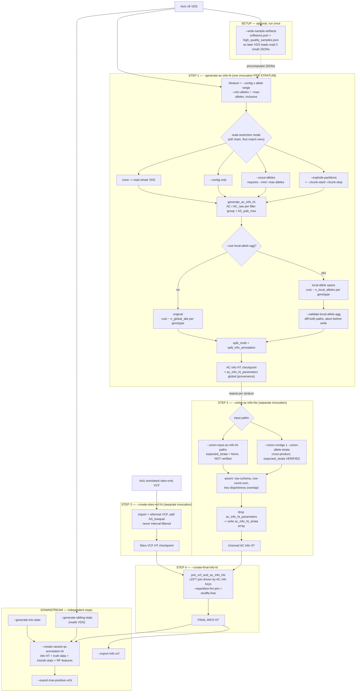
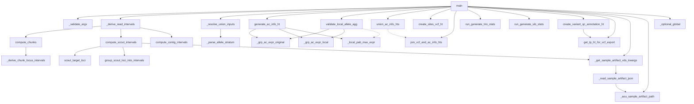

# `generate_variant_qc_annotations.py` — flowcharts (review aid)

> Scratch doc for reviewing branch `kl/info_ht_split_workflow` @ `91dd0f46`; not intended to be committed.
> Two charts: (1) **high level** — the info HT is now built by 4 independent CLI invocations, plus how the
> three read-restriction modes and the allele-count stratification interact; (2) **detailed** call graph
> grouped by role, plus a one-line function reference.
>
> The detailed chart is **curated**: closures that only exist to build one expression are folded into their
> parent, and repeated edges to an already-shown node are omitted.

---

## 1. High-level flowchart — info HT pipeline

The old single-pass `--create-info-ht` is replaced by **4 steps that run as separate invocations**, so the
expensive AC aggregation can be stratified, checkpointed, and never repeated. `--generate-ac-info-ht` and
`--union-ac-info-hts` are mutually exclusive in one invocation ([1425-1431](generate_variant_qc_annotations.py#L1425-L1431))
because both write the same checkpoint path.

### How the read-restriction modes interact

`_derive_read_intervals` ([1440-1471](generate_variant_qc_annotations.py#L1440-L1471)) is an **`elif` chain**, so
precedence is `--explode-partitions` > `--scout-alleles` > `--contig`. That matters differently per pair:

| Combination | Behavior | Notes |
|---|---|---|
| `--contig` + `--explode-partitions` | **rejected** | raises at [1401-1405](generate_variant_qc_annotations.py#L1401-L1405) |
| `--contig` + `--scout-alleles` | **supported and coherent** | scout branch wins, but scout applies the contig itself ([1234](generate_variant_qc_annotations.py#L1234) → [1126-1129](generate_variant_qc_annotations.py#L1126-L1129)); result = target loci *within* that contig |
| `--explode-partitions` + `--scout-alleles` | **silently drops scout** | nothing rejects it; chunk branch wins and the scout pass never runs, yet provenance records `scout_alleles=True` ([1722](generate_variant_qc_annotations.py#L1722)) |

Mode shapes, for choosing between them:

- **chunk** (`--explode-partitions`) — aggregates VDS reference-data bounds to derive per-contig sub-intervals for a partition range.
- **scout** (`--scout-alleles`) — cheap rows-only pass finds loci in the allele range, then groups them into intervals that *hug only those loci*. Best for high-allele strata; costs one extra VDS rows pass.
- **contig** (`--contig`) — equal-width intervals tiling the whole contig from reference metadata; **no VDS aggregation at all**, but covers regions with no target loci.

### Review flags found while reading

- **Stratum gaps are never detected.** `--union-allele-strata ":9" "20:"` builds exactly what you declared; alleles 10–19 are simply absent. The row-count check ([797-801](generate_variant_qc_annotations.py#L797-L801)) compares the union to the sum of *inputs you passed*, and the final join is AC-driven so missing variants look like the intentional VCF-only drop ([644-646](generate_variant_qc_annotations.py#L644-L646)). Overlap is caught (duplicate keys), absence is not. `--union-contigs autosomes` = chr1–22 only, no chrX/Y/M.
- **Explicit union paths skip verification** — `expected_strata` is `None` unless `--union-contigs`/`--union-allele-strata` are used ([1503](generate_variant_qc_annotations.py#L1503), [740](generate_variant_qc_annotations.py#L740)).
- **Nested unions lose provenance** — the union output drops `ac_info_ht_parameters` ([821](generate_variant_qc_annotations.py#L821)), so feeding per-contig unions back in makes every input report `params is None`.
- **`validate_local_allele_agg` returns `True` when `--use-local-allele-agg` is off** ([408-412](generate_variant_qc_annotations.py#L408-L412)) — the diff computes both sides unconditionally, so the guard only skips work.
- **`AS_pab_max` equivalence has one hole** — the proof at [237-246](generate_variant_qc_annotations.py#L237-L246) assumes each het carrier's AD entry is non-missing; a *partially* missing `LAD` would let the local path exceed the original. Judged unreachable from GATK output (uninformative reads give 0, not missing).

---

## 2. Detailed call graph + function reference

> Dashed edges are **data flow, not calls**: `main` invokes each of those functions separately and passes the
> output along (`union_ac_info_hts` → the join happens across two invocations; `create_variant_qc_annotation_ht`
> → `get_tp_ht_for_vcf_export` is a later `--export-true-positive-vcfs` step). Every solid edge is a real call.

### Function reference

| Function | Line | One-line description |
|---|---|---|
| `main` | [1570](generate_variant_qc_annotations.py#L1570) | Dispatches every step by argparse flag; loads the VDS only when a selected step reads it. |
| `_validate_args` | [1357](generate_variant_qc_annotations.py#L1357) | Raises `ValueError` for invalid CLI flag combinations. |
| `_derive_read_intervals` | [1440](generate_variant_qc_annotations.py#L1440) | Picks one read-restriction mode (chunk > scout > contig) and returns its intervals, or `None`. |
| `_resolve_union_inputs` | [1487](generate_variant_qc_annotations.py#L1487) | Resolves union input paths and the expected per-stratum parameters used for verification. |
| `_parse_allele_stratum` | [676](generate_variant_qc_annotations.py#L676) | Parses a `MIN:MAX` allele-stratum spec into an inclusive `(min, max)` tuple with optional open bounds. |
| `compute_chunks` | [1252](generate_variant_qc_annotations.py#L1252) | Derives per-contig locus sub-intervals for a chunk of the VDS partition range. |
| `_derive_chunk_locus_intervals` | [1034](generate_variant_qc_annotations.py#L1034) | Aggregates locus bounds per contig over the filtered `variant_data` and splits them into sub-intervals. |
| `compute_scout_intervals` | [1204](generate_variant_qc_annotations.py#L1204) | Runs the scout pass, then groups the resulting target loci into re-read intervals. |
| `scout_target_loci` | [1099](generate_variant_qc_annotations.py#L1099) | Cheap rows-only pass returning loci whose allele count is in range, optionally restricted to one contig. |
| `group_scout_loci_into_intervals` | [1139](generate_variant_qc_annotations.py#L1139) | Chunks sorted target loci into intervals (never spanning contigs) to bound the partition count. |
| `compute_contig_intervals` | [1293](generate_variant_qc_annotations.py#L1293) | Derives equal-width intervals over one contig from reference metadata, with no VDS aggregation. |
| `generate_ac_info_ht` | [283](generate_variant_qc_annotations.py#L283) | Computes AC / AC_raw per filter group plus `AS_pab_max`, then splits multi-allelics. |
| `_grp_ac_expr_original` | [152](generate_variant_qc_annotations.py#L152) | Per-alt AC dicts via `array_agg` over every global alt; cost scales with the site's alt count. |
| `_grp_ac_expr_local` | [183](generate_variant_qc_annotations.py#L183) | Same output, computed by scattering only each genotype's local alleles as `(global_idx, dosage)` pairs. |
| `_local_pab_max_expr` | [226](generate_variant_qc_annotations.py#L226) | `AS_pab_max` in local-allele space, using a shared per-genotype baseline plus a scattered per-allele max. |
| `validate_local_allele_agg` | [375](generate_variant_qc_annotations.py#L375) | Diffs the local-allele aggregation against the original on a subset; fails on empty input or any mismatch. |
| `union_ac_info_hts` | [700](generate_variant_qc_annotations.py#L700) | Unions per-stratum AC info HTs with schema / row-count / key-disjointness assertions and provenance rollup. |
| `create_sites_vcf_ht` | [564](generate_variant_qc_annotations.py#L564) | Imports the AoU annotated sites-only VCF once and reformats it, adding `AS_lowqual`. |
| `join_vcf_and_ac_info_hts` | [634](generate_variant_qc_annotations.py#L634) | Left-joins the sites VCF HT onto the AC info HT keys and moves `AS_pab_max` into `info`. |
| `run_generate_trio_stats` | [837](generate_variant_qc_annotations.py#L837) | Generates trio transmission stats from a dense trio MT and a pedigree. |
| `run_generate_sib_stats` | [856](generate_variant_qc_annotations.py#L856) | Generates sibling stats from the VDS and relatedness info. |
| `create_variant_qc_annotation_ht` | [872](generate_variant_qc_annotations.py#L872) | Assembles the variant QC HT: info, truth data, trio/sib stats, RF features, optional feature imputation. |
| `get_tp_ht_for_vcf_export` | [992](generate_variant_qc_annotations.py#L992) | Builds raw and adj true-positive sites Tables for VQSR VCF export. |
| `_get_sample_artifact_vds_kwargs` | [98](generate_variant_qc_annotations.py#L98) | Builds `get_aou_vds` sample-filtering kwargs from the precomputed sample artifacts. |
| `_read_sample_artifact_json` | [82](generate_variant_qc_annotations.py#L82) | Reads a precomputed sample-artifact JSON, or `None` if it was never written. |
| `_aou_sample_artifact_path` | [63](generate_variant_qc_annotations.py#L63) | Returns the 30-day-storage path for a chunk-invariant sample-level artifact. |
| `_optional_global` | [138](generate_variant_qc_annotations.py#L138) | Returns a Hail literal or a typed missing, so `None` CLI args can be stamped into provenance globals. |
| `get_script_argument_parser` | [1920](generate_variant_qc_annotations.py#L1920) | Builds the argparse parser for every step flag and parameter. |
